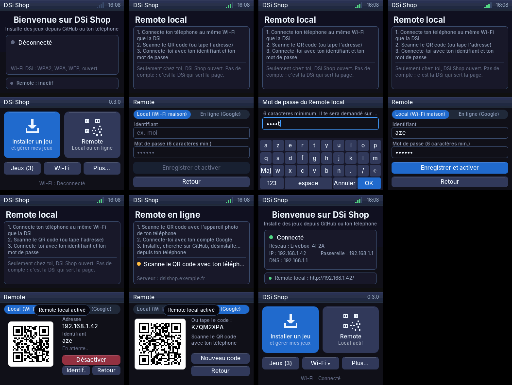
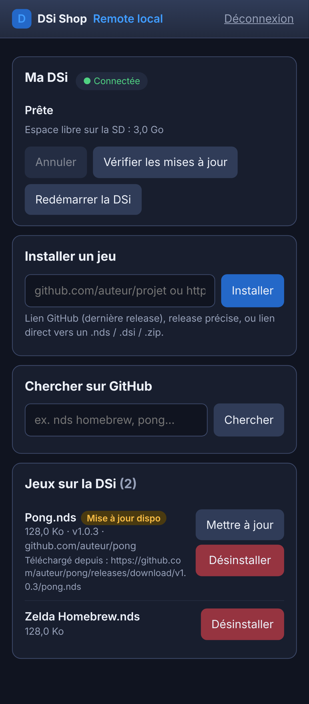

# DSiShopV2

Application homebrew pour **Nintendo DSi** (une appli, pas un jeu), écrite en C avec
[BlocksDS](https://blocksds.skylyrac.net/) : libnds + DSWiFi.


## Ce qui est déjà en place

- **Menu principal** au lancement : deux grandes tuiles **Installer un jeu** et
  **Remote**, plus des raccourcis *Jeux*, *Wi-Fi* et *Plus…* (test Internet, à
  propos, quitter). La DSi se connecte toute seule aux réseaux Wi-Fi enregistrés.
- **Mes jeux** : liste des `.nds` / `.dsi` installés. Chaque jeu a sa fiche : version,
  source, **adresse exacte du téléchargement**, sauvegardes trouvées. Depuis la fiche :
  **mettre à jour**, **revenir à la version précédente**, **supprimer les
  sauvegardes**, **désinstaller**. Le bouton *Vérifier les màj* contrôle tous les jeux
  d'un coup.
- **Remote**, deux façons de piloter la DSi depuis un téléphone (installer, mettre à
  jour, chercher sur GitHub, désinstaller, annuler, redémarrer) :
  - **Local** : la DSi sert elle-même la page sur ton Wi-Fi. Tu choisis un
    **identifiant et un mot de passe** sur la DSi, tu scannes le QR code, tu te
    connectes. Aucun compte, aucun serveur, mais seulement à la maison.
  - **En ligne** : connexion avec un **compte Google**, de n'importe où, via le petit
    serveur de [`remote-server/`](remote-server/README.md) (à héberger).
- **Installer un jeu depuis un lien** : tu tapes le lien d'un projet GitHub (ou l'URL
  directe d'un `.nds`, `.dsi` ou `.zip`), tu appuies sur *Installer* : l'appli récupère
  la dernière release, télécharge le fichier en HTTPS, extrait la ROM si c'est un zip,
  vérifie que c'est bien une ROM DS/DSi, la copie dans `sd:/roms/nds/`, puis la console
  redémarre (au bout de 5 s, ou tout de suite avec le bouton).

- **Rendu** : framebuffer 16 bits sur les deux écrans, rendu 2D logiciel
  (rectangles arrondis anti-aliasés, dégradés, texte anti-aliasé en UTF-8 avec
  accents) et envoi en VRAM par DMA, seulement quand un écran a changé.
- **Interface** : petite lib d'UI en mode immédiat (boutons, listes, en-têtes,
  toasts, spinner) avec le tactile *et* la croix + A (focus 2D automatique).
- **Clavier virtuel AZERTY** (majuscules, symboles) pour taper les mots de passe.
- **Wi-Fi** : DSWiFi en mode DSi, donc **WPA2/WPA/WEP/ouvert** (en mode DS, seulement
  WEP/ouvert). Connexion aux réseaux enregistrés dans les paramètres de la console,
  ou recherche de réseaux + saisie du mot de passe. Affiche IP, passerelle, DNS.
- **HTTPS** : libcurl + Mbed TLS, avec vérification des certificats (bundle Mozilla
  embarqué dans `data/cacert.pem`). Un petit client HTTP « maison » sert aussi au
  test de connexion.
- L'ARM9 passe à 134 MHz en mode DSi.

## Arborescence

```
source/
  main.c        init matérielle + boucle principale
  app.c/.h      écrans de l'appli et navigation  ← c'est ici que tu ajoutes tes écrans
  ui.c/.h       widgets (boutons, listes, thème de couleurs)
  keyboard.c/.h clavier virtuel
  gfx.c/.h      primitives de dessin et texte (portable, sans libnds)
  gfx_hw.c      config VRAM / fonds bitmap (spécifique DS)
  net.c/.h      Wi-Fi + HTTP (DSWiFi)
  installer.c/.h  installation de jeux (API GitHub, libcurl, vérif ROM)
  splitfile.c/.h  fichier découpé en morceaux de 1 Go (limite FAT32 de 4 Go)
  zip.c/.h      extraction ZIP / ZIP64 (portable, testé sur PC)
  cacert.s      embarque data/cacert.pem (certificats racines)
  games.c/.h    jeux installés, désinstallation, registre .dsishop.tsv (portable)
  remote.c/.h   client du serveur Remote (long polling HTTPS, cothread)
  remote_proto.c/.h  protocole texte DSi <-> serveur (portable, testé sur PC)
  lremote.c/.h  Remote local : identifiants, sessions, HTTP, JSON (portable)
  lremote_net.c serveur TCP non bloquant (sockets BSD, portable)
  lremote_glue.c  liaison Remote local <-> installeur / jeux / redémarrage
  web/          page du Remote local (intégrée par tools/gen_page.py)
  sha256.c/.h   SHA-256 (empreinte du mot de passe, aléatoire)
  thirdparty/qrcodegen  générateur de QR codes de Nayuki (licence MIT)
  font.h        format des polices
  font_data.c   polices générées (ne pas éditer)
tools/
  gen_font.py   régénère font_data.c (Pillow + police Inter)
  gen_icon.py   régénère icon.gif
  sim/          simulateur PC : exécute app/ui/gfx avec un faux réseau et sort des captures
  test/         tests PC de zip.c, splitfile.c, games.c, remote_proto.c
remote-server/  serveur du Remote (Node.js sans dépendance) + site web pour le téléphone
```

## Compiler

### Avec Docker (le plus simple)

```sh
docker run --rm -v "$PWD":/work -w /work skylyrac/blocksds:slim-v1.25.0 sh -c \
  "wf-pacman -Sy --noconfirm toolchain-gcc-arm-none-eabi-zlib blocksds-mbedtls blocksds-libcurl && make"
```

### Avec BlocksDS installé

Suis le [guide d'installation](https://blocksds.skylyrac.net/docs/setup/), installe
les bibliothèques HTTPS une fois, puis compile :

```sh
wf-pacman -Sy toolchain-gcc-arm-none-eabi-zlib blocksds-mbedtls blocksds-libcurl
make
```

Ça produit `DSiShop.nds`. Le CI GitHub (`.github/workflows/build.yml`) compile aussi la
ROM à chaque push : récupère-la dans les artefacts du run.

### Tests PC

```sh
(cd remote-server && npm test)      # serveur Remote
make -C tools/test check            # zip, morceaux, jeux installés, protocole Remote...
make -C tools/test check BIG=--big  # + archive ZIP64 de 4,5 Go (fichiers creux)
```

### Simulateur PC

Pour itérer sur l'interface sans console ni émulateur :

```sh
make -C tools/sim
./tools/sim/dsishop_sim /tmp/captures   # écrit des .ppm des deux écrans
```

## Lancer sur la DSi

Copie `DSiShop.nds` sur la carte SD et lance-le depuis **TWiLight Menu++** (ou
hiyaCFW / Unlaunch). Il faut qu'il tourne en **mode DSi** pour avoir le WPA2 : c'est le
cas par défaut avec TWiLight Menu++ depuis la SD de la DSi. Pour tester dans un
émulateur : melonDS (en mode DSi, avec les fichiers BIOS/NAND de la DSi pour le Wi-Fi).

## Installer un jeu : détails

Formats de lien acceptés :

| Tu tapes | Ce qui est téléchargé |
|---|---|
| `github.com/auteur/projet` ou `auteur/projet` | dernière release (fichier `.nds`, sinon `.dsi`, sinon `.zip`) |
| `github.com/auteur/projet/releases/tag/v1.0` | cette release précise |
| `https://site.com/jeu.nds` (`.dsi`, `.zip`) | le fichier tel quel |

- Le `https://` est optionnel.
- Si c'est un `.zip`, la première ROM `.nds` (sinon `.dsi`) trouvée dedans est extraite.
- **Fichiers de plus de 4 Go** : la carte SD est en FAT32, qui limite chaque fichier à
  4 Go. Le téléchargement est donc écrit en **morceaux de 1 Go**
  (`.dsishop_download.000`, `.001`…), puis relu comme un seul fichier. Les archives
  **ZIP64** (zip de plus de 4 Go, ex. un pack) sont gérées : la ROM est extraite
  directement depuis les morceaux, qui sont ensuite supprimés. Une ROM DS/DSi fait au
  plus 512 Mo, donc la ROM installée tient toujours en un seul fichier. L'espace libre
  est vérifié avant de télécharger.
- La ROM est validée grâce au CRC de son en-tête avant d'être installée, et une
  version déjà présente est remplacée.
- Le dossier d'installation est `sd:/roms/nds/` en mode DSi (`fat:/roms/nds/` sur
  linker en mode DS). Tu peux le changer dans `installer_init()`
  (`source/installer.c`).
- Redémarrage : `systemReboot()` sur DSi. En mode DS, l'appli quitte et retourne au
  menu de lancement.
- **Si tu as « Certificat HTTPS refusé »**, vérifie la date et l'heure de la console :
  les certificats sont vérifiés par rapport à l'horloge. Tu peux aussi mettre ton
  propre bundle dans `sd:/_dsishop/cacert.pem`, il remplacera celui qui est embarqué.
- L'API GitHub sans compte est limitée à 60 requêtes par heure et par adresse IP.

## Mises à jour des jeux

À chaque installation, DSi Shop retient dans `sd:/roms/nds/.dsishop.tsv` le lien
saisi, la release (tag GitHub), **l'adresse exacte du fichier téléchargé**, et les
en-têtes `ETag` / `Last-Modified` du serveur.

Pour vérifier s'il y a du nouveau :
- **projet GitHub** (ou fichier de release GitHub) : comparaison du tag de la
  dernière release avec celui installé ;
- **lien direct** : requête `HEAD`, comparaison de l'ETag ou de la date. Si le
  serveur ne donne ni l'un ni l'autre, le fichier est téléchargé et comparé octet
  par octet à la version installée.

Pendant une mise à jour :
1. la nouvelle version est téléchargée et vérifiée **avant** de toucher à l'ancienne
   (une mise à jour ratée ne casse rien) ;
2. elle garde **exactement le même nom de fichier**, même si la release a renommé le
   sien : les sauvegardes (`Jeu.sav`, rattachées au nom de la ROM) restent donc
   associées au jeu ;
3. l'ancienne version est déplacée dans `sd:/roms/nds/.dsishop_old/`, d'où le bouton
   **Revenir à la version précédente**.

Si le jeu plante après une mise à jour, **Supprimer les sauvegardes** efface
`Jeu.sav`, `.sav1`-`.sav9`, `.pub`, `.prv` et `.bak`, à côté de la ROM ou dans
`saves/` (le dossier par défaut de TWiLight Menu++), après confirmation. Les jeux qui
rangent leurs données ailleurs (leur propre dossier sur la SD) ne sont pas concernés.
La désinstallation garde les sauvegardes, pour les retrouver si tu réinstalles.

## Remote local



Sur la DSi : **Remote**, onglet **Local**, choisis un identifiant (3 caractères min.)
et un mot de passe (6 min.), puis **Enregistrer et activer**. La DSi affiche un QR
code vers `http://<son adresse IP>/`. Sur ton téléphone, connecté au **même Wi-Fi**,
scanne-le et connecte-toi.



Le serveur web tourne sur la DSi (port 80) tant que DSi Shop est ouvert, et il
redémarre tout seul au lancement suivant s'il est activé. Il est servi par
`source/lremote.c` (HTTP, sessions, JSON) et `source/lremote_net.c` (sockets non
bloquantes, traitées à chaque frame). La page vient de `source/web/` (lance
`python3 tools/gen_page.py` après une modification).

Sécurité :
- le mot de passe n'est **jamais stocké** : `sd:/_dsishop/local.cfg` contient
  l'identifiant, un sel aléatoire et une empreinte SHA-256 (2000 tours) ;
- session par cookie aléatoire de 256 bits, `HttpOnly`, `SameSite=Strict`, 12 h ;
- **5 essais ratés = blocage** de 30 s, puis 1 min, 2 min… (5 min max) ;
- les requêtes d'écriture exigent l'en-tête `X-DSiShop` (protection CSRF), et seule
  une **adresse IP** est acceptée comme nom d'hôte (protection contre le « DNS
  rebinding ») ;
- commandes revalidées sur la DSi (noms de fichiers sans dossier, liens sans espace).

Limite : la page est en HTTP simple, comme toutes les pages d'appareils locaux (box,
imprimantes…). Sur un Wi-Fi public, préfère le Remote en ligne.

## Remote en ligne : mise en route

1. Héberge le serveur : voir [`remote-server/README.md`](remote-server/README.md)
   (identifiant Google, Docker, HTTPS).
2. Donne son adresse à la DSi : `make REMOTE_SERVER=https://ton-site` (après un
   `make clean`), ou un fichier `sd:/_dsishop/server.txt` contenant l'adresse.
3. Sur la DSi : **Remote**, puis scanne le QR code. Une fois associée, la DSi se
   reconnecte toute seule au Remote à chaque lancement.

Le jeton secret de la DSi est stocké dans `sd:/_dsishop/remote.cfg`. Le bouton
**Délier** l'efface et génère un nouveau QR code.

Les installations lancées depuis le téléphone ne redémarrent pas la console
automatiquement, pour pouvoir en enchaîner plusieurs. Le bouton *Redémarrer la DSi*
du site s'en charge.

### Pourquoi un serveur, et pas la DSi elle-même ?

La DSi pourrait servir une petite page web sur ton réseau local (le Wi-Fi le
permet). Mais la **connexion Google** est impossible dans ce cas :
- Google n'accepte la connexion que depuis un site **public en HTTPS** déclaré dans
  la console Google. Une adresse locale comme `http://192.168.1.42` est refusée ;
- la DSi n'aurait pas de certificat HTTPS valide pour son adresse locale ;
- elle ne serait joignable que depuis le même Wi-Fi, et seulement quand elle est
  allumée sur DSi Shop.

D'où les deux modes : le **Remote local** (la DSi sert la page, identifiant + mot de
passe, à la maison) et le **Remote en ligne** (serveur + Google, de partout).

## Ajouter un écran

1. Ajoute une valeur à l'enum `app_screen_t` dans `source/app.c`.
2. Écris une fonction `screen_xxx(canvas_t *c, const input_t *in)` pour l'écran du bas
   (avec `ui_button`, `ui_list_item`...) et un `case` dans `draw_top()` pour celui du haut.
3. Branche-la dans le `switch` de `app_frame()` et appelle `go(SCREEN_XXX)` pour y aller.

## Licences

- Code : à toi de choisir.
- Police : [Inter](https://rsms.me/inter), SIL Open Font License 1.1.
- `source/thirdparty/qrcodegen.*` : [QR Code generator](https://www.nayuki.io/page/qr-code-generator-library)
  de Project Nayuki (licence MIT).
- `data/cacert.pem` : certificats racines de Mozilla (MPL 2.0), via
  [curl.se/ca](https://curl.se/docs/caextract.html).
