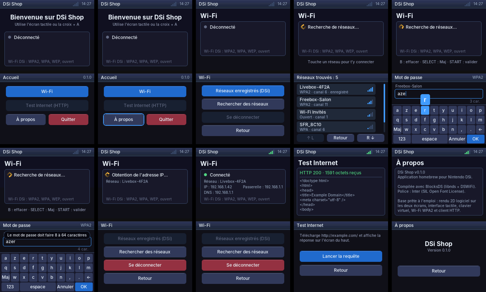

# DSiShopV2

Application homebrew pour **Nintendo DSi** (une appli, pas un jeu), écrite en C avec
[BlocksDS](https://blocksds.skylyrac.net/) : libnds + DSWiFi.



## Ce qui est déjà en place

- **Rendu** : framebuffer 16 bits sur les deux écrans, rendu 2D logiciel
  (rectangles arrondis anti-aliasés, dégradés, texte anti-aliasé en UTF-8 avec
  accents) et envoi en VRAM par DMA, seulement quand un écran a changé.
- **Interface** : petite lib d'UI en mode immédiat (boutons, listes, en-têtes,
  toasts, spinner) avec le tactile *et* la croix + A (focus 2D automatique).
- **Clavier virtuel AZERTY** (majuscules, symboles) pour taper les mots de passe.
- **Wi-Fi** : DSWiFi en mode DSi, donc **WPA2/WPA/WEP/ouvert** (en mode DS, seulement
  WEP/ouvert). Connexion aux réseaux enregistrés dans les paramètres de la console,
  ou recherche de réseaux + saisie du mot de passe. Affiche IP, passerelle, DNS.
- **HTTP** : client `GET` asynchrone (dans une cothread, l'UI ne gèle pas).
  Pas de HTTPS pour l'instant (il faudra ajouter mbedTLS ou BearSSL).
- L'ARM9 passe à 134 MHz en mode DSi.

## Arborescence

```
source/
  main.c        init matérielle + boucle principale
  app.c/.h      écrans de l'appli et navigation  ← c'est ici que tu ajoutes tes écrans
  ui.c/.h       widgets (boutons, listes, thème de couleurs)
  keyboard.c/.h clavier virtuel
  gfx.c/.h      primitives de dessin et texte (portable, sans libnds)
  gfx_hw.c      config VRAM / fonds bitmap (spécifique DS)
  net.c/.h      Wi-Fi + HTTP (DSWiFi)
  font.h        format des polices
  font_data.c   polices générées (ne pas éditer)
tools/
  gen_font.py   régénère font_data.c (Pillow + police Inter)
  gen_icon.py   régénère icon.gif
  sim/          simulateur PC : exécute app/ui/gfx avec un faux réseau et sort des captures
```

## Compiler

### Avec Docker (le plus simple)

```sh
docker run --rm -v "$PWD":/work -w /work skylyrac/blocksds:slim-v1.25.0 make
```

### Avec BlocksDS installé

Suis le [guide d'installation](https://blocksds.skylyrac.net/docs/setup/), puis :

```sh
make
```

Ça produit `DSiShop.nds`. Le CI GitHub (`.github/workflows/build.yml`) compile aussi la
ROM à chaque push : récupère-la dans les artefacts du run.

### Simulateur PC

Pour itérer sur l'interface sans console ni émulateur :

```sh
make -C tools/sim
./tools/sim/dsishop_sim /tmp/captures   # écrit des .ppm des deux écrans
```

## Lancer sur la DSi

Copie `DSiShop.nds` sur la carte SD et lance-le depuis **TWiLight Menu++** (ou
hiyaCFW / Unlaunch). Il faut qu'il tourne en **mode DSi** pour avoir le WPA2 : c'est le
cas par défaut avec TWiLight Menu++ depuis la SD de la DSi. Pour tester dans un
émulateur : melonDS (en mode DSi, avec les fichiers BIOS/NAND de la DSi pour le Wi-Fi).

## Ajouter un écran

1. Ajoute une valeur à l'enum `app_screen_t` dans `source/app.c`.
2. Écris une fonction `screen_xxx(canvas_t *c, const input_t *in)` pour l'écran du bas
   (avec `ui_button`, `ui_list_item`...) et un `case` dans `draw_top()` pour celui du haut.
3. Branche-la dans le `switch` de `app_frame()` et appelle `go(SCREEN_XXX)` pour y aller.

## Licences

- Code : à toi de choisir.
- Police : [Inter](https://rsms.me/inter), SIL Open Font License 1.1.
