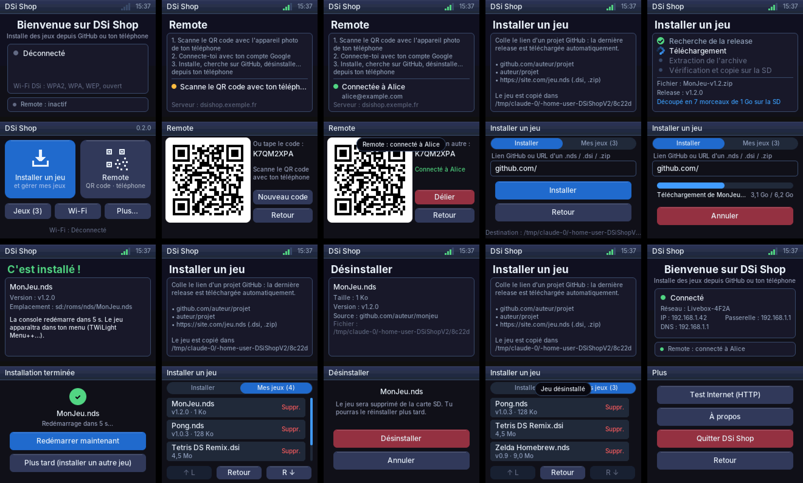
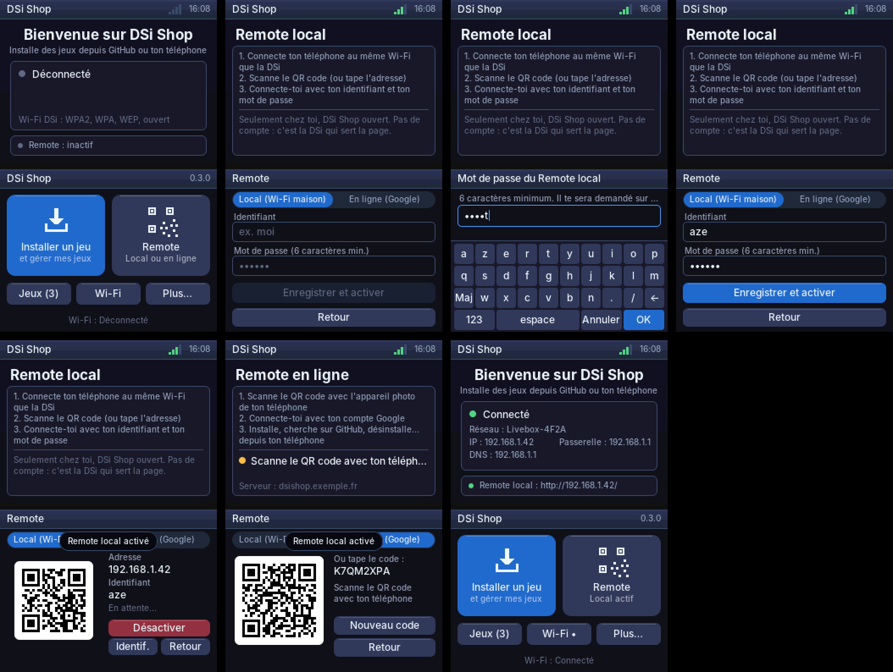
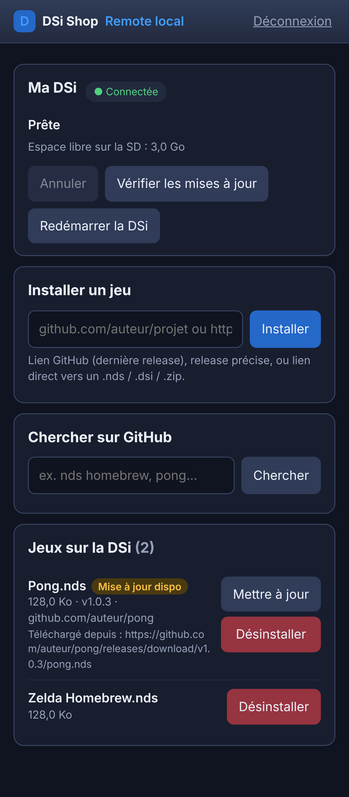

# DSiShopV2

Application homebrew pour **Nintendo DSi** (une appli, pas un jeu), écrite en C avec
[BlocksDS](https://blocksds.skylyrac.net/) : libnds + DSWiFi.



## Ce qui est déjà en place

- **Menu principal** au lancement : deux grandes tuiles **Installer un jeu** et
  **Remote**, plus des raccourcis *Jeux*, *Wi-Fi* et *Plus…* (test Internet, à
  propos, quitter). La DSi se connecte toute seule aux réseaux Wi-Fi enregistrés.
- **Mes jeux** : liste des `.nds` / `.dsi` installés. Chaque jeu a sa fiche : version,
  source, **adresse exacte du téléchargement**, sauvegardes trouvées. Depuis la fiche :
  **mettre à jour**, **revenir à la version précédente**, **supprimer les
  sauvegardes**, **désinstaller**. Le bouton *Vérifier les màj* contrôle tous les jeux
  d'un coup.
- **Remote**, deux façons de piloter la DSi depuis un téléphone (installer, mettre à
  jour, chercher sur GitHub, désinstaller, annuler, redémarrer) :
  - **Local** : la DSi sert elle-même la page sur ton Wi-Fi. Tu choisis un
    **identifiant et un mot de passe** sur la DSi, tu scannes le QR code, tu te
    connectes. Aucun compte, aucun serveur, mais seulement à la maison.
  - **En ligne** : connexion avec un **compte Google**, de n'importe où, via le petit
    serveur de [`remote-server/`](remote-server/README.md) (à héberger).
- **Installer un jeu depuis un lien** : tu tapes le lien d'un projet GitHub (ou l'URL
  directe d'un `.nds`, `.dsi` ou `.zip`), tu appuies sur *Installer* : l'appli récupère
  la dernière release, télécharge le fichier en HTTPS, extrait la ROM si c'est un zip,
  vérifie que c'est bien une ROM DS/DSi, la copie dans `sd:/roms/nds/`, puis la console
  redémarre (au bout de 5 s, ou tout de suite avec le bouton).

- **Rendu** : framebuffer 16 bits sur les deux écrans, rendu 2D logiciel
  (rectangles arrondis anti-aliasés, dégradés, texte anti-aliasé en UTF-8 avec
  accents) et envoi en VRAM par DMA, seulement quand un écran a changé.
- **Interface** : petite lib d'UI en mode immédiat (boutons, listes, en-têtes,
  toasts, spinner) avec le tactile *et* la croix + A (focus 2D automatique).
- **Clavier virtuel AZERTY** (majuscules, symboles) pour taper les mots de passe.
- **Wi-Fi** : DSWiFi en mode DSi, donc **WPA2/WPA/WEP/ouvert** (en mode DS, seulement
  WEP/ouvert). Connexion aux réseaux enregistrés dans les paramètres de la console,
  ou recherche de réseaux + saisie du mot de passe. Affiche IP, passerelle, DNS.
- **HTTPS** : libcurl + Mbed TLS, avec vérification des certificats (bundle Mozilla
  embarqué dans `data/cacert.pem`). Un petit client HTTP « maison » sert aussi au
  test de connexion.
- L'ARM9 passe à 134 MHz en mode DSi.

## Arborescence

```
source/
  main.c        init matérielle + boucle principale
  app.c/.h      écrans de l'appli et navigation  ← c'est ici que tu ajoutes tes écrans
  ui.c/.h       widgets (boutons, listes, thème de couleurs)
  keyboard.c/.h clavier virtuel
  gfx.c/.h      primitives de dessin et texte (portable, sans libnds)
  gfx_hw.c      config VRAM / fonds bitmap (spécifique DS)
  net.c/.h      Wi-Fi + HTTP (DSWiFi)
  installer.c/.h  installation de jeux (API GitHub, libcurl, vérif ROM)
  splitfile.c/.h  fichier découpé en morceaux de 1 Go (limite FAT32 de 4 Go)
  zip.c/.h      extraction ZIP / ZIP64 (portable, testé sur PC)
  sysupdate.c/.h  mise à jour de TWiLight Menu++ par paquets (portable, testé sur PC)
  twlini.c/.h   réglages de TWiLight Menu++ : lancement de DSi Shop au démarrage (portable)
  instinfo.c/.h pré-description d'une installation : taille, auteur, débit (portable)
  sdscan.c/.h   recherche de tous les jeux de la carte SD, par étapes (portable)
  cacert.s      embarque data/cacert.pem (certificats racines)
  games.c/.h    jeux installés, désinstallation, registre .dsishop.tsv (portable)
  remote.c/.h   client du serveur Remote (long polling HTTPS, cothread)
  remote_proto.c/.h  protocole texte DSi <-> serveur (portable, testé sur PC)
  lremote.c/.h  Remote local : identifiants, sessions, HTTP, JSON (portable)
  lremote_net.c serveur TCP non bloquant (sockets BSD, portable)
  lremote_glue.c  liaison Remote local <-> installeur / jeux / redémarrage
  web/          page du Remote local (intégrée par tools/gen_page.py)
  sha256.c/.h   SHA-256 (empreinte du mot de passe, aléatoire)
  thirdparty/qrcodegen  générateur de QR codes de Nayuki (licence MIT)
  font.h        format des polices
  font_data.c   polices générées (ne pas éditer)
tools/
  gen_font.py   régénère font_data.c (Pillow + police Inter)
  gen_icon.py   régénère icon.gif
  sim/          simulateur PC : exécute app/ui/gfx avec un faux réseau et sort des captures
  test/         tests PC de zip.c, splitfile.c, sysupdate.c, games.c, remote_proto.c
catalog-server/ serveur du catalogue (Python sans dépendance) : recherche de jeux,
                relais GitHub, paquets de mise à jour de TWiLight Menu++
remote-server/  serveur du Remote (Node.js sans dépendance) + site web pour le téléphone
```

## Compiler

### Avec Docker (le plus simple)

```sh
docker run --rm -v "$PWD":/work -w /work skylyrac/blocksds:slim-v1.25.0 sh -c \
  "wf-pacman -Sy --noconfirm toolchain-gcc-arm-none-eabi-zlib blocksds-mbedtls blocksds-libcurl && make"
```

### Avec BlocksDS installé

Suis le [guide d'installation](https://blocksds.skylyrac.net/docs/setup/), installe
les bibliothèques HTTPS une fois, puis compile :

```sh
wf-pacman -Sy toolchain-gcc-arm-none-eabi-zlib blocksds-mbedtls blocksds-libcurl
make
```

Ça produit `DSiShop.nds`. Le CI GitHub (`.github/workflows/build.yml`) compile aussi la
ROM à chaque push : récupère-la dans les artefacts du run.

### Tests PC

```sh
(cd remote-server && npm test)      # serveur Remote
make -C tools/test check            # zip, morceaux, jeux installés, protocole Remote...
make -C tools/test check BIG=--big  # + archive ZIP64 de 4,5 Go (fichiers creux)
```

### Simulateur PC

Pour itérer sur l'interface sans console ni émulateur :

```sh
make -C tools/sim
./tools/sim/dsishop_sim /tmp/captures   # écrit des .ppm des deux écrans
```

## Lancer sur la DSi

Copie `DSiShop.nds` sur la carte SD et lance-le depuis **TWiLight Menu++** (ou
hiyaCFW / Unlaunch). Il faut qu'il tourne en **mode DSi** pour avoir le WPA2 : c'est le
cas par défaut avec TWiLight Menu++ depuis la SD de la DSi. Pour tester dans un
émulateur : melonDS (en mode DSi, avec les fichiers BIOS/NAND de la DSi pour le Wi-Fi).

## Installer un jeu : détails

Formats de lien acceptés :

| Tu tapes | Ce qui est téléchargé |
|---|---|
| `github.com/auteur/projet` ou `auteur/projet` | dernière release (fichier `.nds`, sinon `.dsi`, sinon `.zip`) |
| `github.com/auteur/projet/releases/tag/v1.0` | cette release précise |
| `https://site.com/jeu.nds` (`.dsi`, `.zip`) | le fichier tel quel |

- Le `https://` est optionnel.
- Si c'est un `.zip`, la première ROM `.nds` (sinon `.dsi`) trouvée dedans est extraite.
- **Fichiers de plus de 4 Go** : la carte SD est en FAT32, qui limite chaque fichier à
  4 Go. Le téléchargement est donc écrit en **morceaux de 1 Go**
  (`.dsishop_download.000`, `.001`…), puis relu comme un seul fichier. Les archives
  **ZIP64** (zip de plus de 4 Go, ex. un pack) sont gérées : la ROM est extraite
  directement depuis les morceaux, qui sont ensuite supprimés. Une ROM DS/DSi fait au
  plus 512 Mo, donc la ROM installée tient toujours en un seul fichier. L'espace libre
  est vérifié avant de télécharger.
- La ROM est validée grâce au CRC de son en-tête avant d'être installée, et une
  version déjà présente est remplacée.
- Le dossier d'installation est `sd:/roms/nds/` en mode DSi (`fat:/roms/nds/` sur
  linker en mode DS). Tu peux le changer dans `installer_init()`
  (`source/installer.c`).
- Redémarrage : `systemReboot()` sur DSi. En mode DS, l'appli quitte et retourne au
  menu de lancement.
- **Si tu as « Certificat HTTPS refusé »**, vérifie la date et l'heure de la console :
  les certificats sont vérifiés par rapport à l'horloge. Tu peux aussi mettre ton
  propre bundle dans `sd:/_dsishop/cacert.pem`, il remplacera celui qui est embarqué.
- L'API GitHub sans compte est limitée à 60 requêtes par heure et par adresse IP.

## Mises à jour des jeux

À chaque installation, DSi Shop retient dans `sd:/roms/nds/.dsishop.tsv` le lien
saisi, la release (tag GitHub), **l'adresse exacte du fichier téléchargé**, et les
en-têtes `ETag` / `Last-Modified` du serveur.

Pour vérifier s'il y a du nouveau :
- **projet GitHub** (ou fichier de release GitHub) : comparaison du tag de la
  dernière release avec celui installé ;
- **lien direct** : requête `HEAD`, comparaison de l'ETag ou de la date. Si le
  serveur ne donne ni l'un ni l'autre, le fichier est téléchargé et comparé octet
  par octet à la version installée.

Pendant une mise à jour :
1. la nouvelle version est téléchargée et vérifiée **avant** de toucher à l'ancienne
   (une mise à jour ratée ne casse rien) ;
2. elle garde **exactement le même nom de fichier**, même si la release a renommé le
   sien : les sauvegardes (`Jeu.sav`, rattachées au nom de la ROM) restent donc
   associées au jeu ;
3. l'ancienne version est déplacée dans `sd:/roms/nds/.dsishop_old/`, d'où le bouton
   **Revenir à la version précédente**.

Si le jeu plante après une mise à jour, **Supprimer les sauvegardes** efface
`Jeu.sav`, `.sav1`-`.sav9`, `.pub`, `.prv` et `.bak`, à côté de la ROM ou dans
`saves/` (le dossier par défaut de TWiLight Menu++), après confirmation. Les jeux qui
rangent leurs données ailleurs (leur propre dossier sur la SD) ne sont pas concernés.
La désinstallation garde les sauvegardes, pour les retrouver si tu réinstalles.

## Catalogue de jeux

La recherche et « Parcourir » interrogent le serveur du catalogue (`catalog-server/catalog.py`).
Sa source principale est **Universal-DB** (db.universal-team.net) : une seule requête toutes
les 6 heures donne la liste triée à la main des projets DS/DSi hébergés sur GitHub avec un
`.nds`, `.dsi` ou `.zip` (environ 70 projets), sans limite de débit GitHub. L'exploration de
GitHub (par mots-clés) ne fait que compléter cette liste ; un projet présent dans les deux
n'apparaît qu'une fois. La console n'a rien de spécial à savoir : elle reçoit toujours les
mêmes lignes « auteur / projet / étoiles / version / description » et installe la dernière
release GitHub du projet. La liste est gardée dans `udb.json` (`UDB_FILE`) pour repartir
tout de suite après un redémarrage. Tests : `python3 catalog-server/test_udb.py`.

### Mise à jour automatique du serveur

Avec `AUTO_UPDATE=1`, le serveur compare `catalog.py` avec la copie GitHub toutes les
10 secondes (`UPDATE_EVERY`), par une requête conditionnelle (ETag) qui ne coûte presque
rien. Quand le fichier a changé :

1. le nouveau fichier est vérifié : il doit se charger sans erreur, sinon il est ignoré
   (et pas réessayé tant qu'il ne change pas) ;
2. les **nouveaux téléchargements sont mis en pause** (réponse 503, la console réessaie) ;
   la recherche, `/health` et le manifeste continuent de répondre ;
3. les téléchargements déjà en cours **vont jusqu'au bout** (30 minutes au plus,
   `UPDATE_DRAIN_MAX`) ;
4. l'ancien fichier est gardé dans `catalog.py.prev`, le nouveau le remplace, et le
   serveur se relance tout seul (même processus, mêmes réglages).

La branche suivie est `UPDATE_BRANCH` (par défaut celle de développement ; mets `main`
une fois la fusion faite). GitHub met ses fichiers en cache environ 5 minutes : compte
donc quelques minutes entre un push et la bascule. `/health` affiche en dernier champ
les 8 premiers caractères de l'empreinte du fichier qui tourne. Quiconque peut pousser
sur la branche suivie peut donc modifier le code du serveur : garde-la pour toi.
Tests : `python3 catalog-server/test_autoupdate.py`.

## Mettre à jour TWiLight Menu++

Menu **Plus → Mettre à jour TWiLight Menu++** : l'appli compare la version installée
(`version.txt` à la racine de la carte SD) avec la dernière release, puis l'installe.

La release officielle est un `.7z` compressé avec un dictionnaire de 16 Mo : impossible
à décompresser sur une DSi (16 Mo de RAM en tout). C'est donc le **serveur du catalogue**
(`catalog-server/catalog.py`) qui la télécharge, l'extrait et la redécoupe en petits
paquets `.zip` (8 Mo extraits au plus, sauf un fichier plus gros, seul dans son paquet) :

- la console télécharge un paquet, vérifie son SHA-256, l'extrait, le supprime, puis
  passe au suivant ;
- chaque fichier est écrit à côté de sa destination puis la remplace : une coupure ne
  laisse jamais un fichier à moitié écrit ;
- le numéro du prochain paquet est noté dans `_dsishop/twilight.state` : après une
  coupure, la mise à jour **reprend** au paquet où elle s'était arrêtée ;
- `BOOT.NDS` et `version.txt` sont dans le **dernier** paquet : tant que la mise à jour
  n'est pas finie, l'ancien menu démarre encore et l'ancienne version reste affichée ;
- les fichiers de `title/` (hiyaCFW) et `ntrboot.nds` ne sont mis à jour que s'ils
  existent déjà sur la carte ; `roms/`, les réglages et les sauvegardes ne sont jamais
  touchés. Rien n'est écrit sur la NAND.

Seule la carte SD de la console est gérée (mode DSi), pas les linkers.

Côté serveur, il faut une commande 7-Zip (`7zz`, `7z`, `7za`, `7zr` ou `bsdtar`) :

```sh
sudo apt install p7zip-full
python3 catalog-server/catalog.py      # les paquets vont dans ./twilight (TWILIGHT_DIR)
```

Le premier appel à `/twilight/manifest` lance la préparation en arrière-plan (réponse
503 en attendant, la console propose de réessayer) ; ensuite une nouvelle release est
cherchée toutes les 30 minutes. Tests : `python3 catalog-server/test_twilight.py`, et
`make -C tools/test check` qui applique de vrais paquets du serveur avec le code de la
console sur une fausse carte SD (coupure, reprise, paquet corrompu).

## Menu principal et « Gérer les jeux »

DSi Shop vise à être un lanceur « universel » : le menu principal a deux grandes tuiles
(**Installer un jeu** et **Gérer les jeux**), deux raccourcis (Wi-Fi, Plus…) et, tout en bas,
une case **Remote** (commande depuis un téléphone) avec une pastille verte quand il est actif.

**Gérer les jeux** ouvre l'onglet **Toute la SD** : il parcourt tous les dossiers de la carte
(jusqu'à 7 niveaux) et liste tous les jeux `.nds` / `.dsi` trouvés, quel que soit leur dossier,
avec leur taille, leur dossier, et un badge « DSi Shop » pour ceux du dossier d'installation.
L'analyse se fait par petites étapes à chaque image : l'écran reste fluide, et on peut la
relancer avec « Rescanner » (elle se refait aussi toute seule après une installation ou une
suppression). Les dossiers du système (`_nds`, `title`, `private`, `DCIM`, `luma`, `3ds`…) et
les dossiers cachés sont ignorés ; la liste est limitée aux 256 premiers jeux. En haut,
un résumé : nombre de jeux, dossiers parcourus, place prise.

Toucher un jeu ouvre sa fiche : sauvegardes, version précédente, suppression. Pour un jeu
rangé hors du dossier de DSi Shop, il n'y a pas de mise à jour automatique (on ne sait pas d'où
il vient) et « Désinstaller » devient « Supprimer le jeu » ; aucun fichier de registre n'est
créé dans ses dossiers. L'onglet « Mes jeux » reste la liste des jeux installés par DSi Shop.

## Pré-description et mode Verbose

Avant de télécharger, une installation lancée depuis la console s'arrête sur une
**pré-description** : l'écran du haut montre le nom du fichier, le projet, l'**auteur**, la
**version** (tag de la release GitHub), la **taille**, le dossier de destination et la place
libre sur la carte SD. Il faut confirmer avec « Installer » (ou START), ou annuler avec B ;
s'il n'y a pas assez de place, la confirmation est bloquée. Pour un lien direct, l'auteur et
la version ne sont pas connus : on affiche le site, et la taille si le serveur l'indique
(requête HEAD). Les installations demandées depuis le Remote et les mises à jour de jeux n'ont
personne pour confirmer : elles n'ont pas de pré-description.

**Plus → Réglages → Verbose** (OUI par défaut, mémorisé dans `_dsishop/verbose` sur la SD) :
- les messages d'étape sont plus précis (projet recherché, vérification du CRC16…) ;
- l'écran du haut montre un journal des dernières étapes avec leur durée (`[12s] …`),
  y compris un point tous les 25 % du téléchargement ;
- l'écran du bas ajoute le débit et la durée restante du téléchargement ;
- la pré-description ajoute le format (archive .zip) et la place libre.

Avec NON, on retrouve l'affichage résumé d'avant. Le thème et le lancement au démarrage sont
dans le même écran Réglages.

## Mettre à jour DSi Shop

Menu **Plus → À propos → Rechercher une mise à jour** : l'appli demande la dernière
release GitHub du projet (via le serveur du catalogue), compare son numéro avec
`APP_VERSION`, télécharge `DSiShop.nds`, vérifie que c'est une ROM DS valide puis remplace
son propre fichier sur la carte SD (son chemin vient de `argv[0]`). L'ancienne version
est gardée dans `_dsishop/DSiShop.old.nds` ; il reste à redémarrer la console.

Pour publier une version : augmenter `APP_VERSION` dans `source/app.h` et pousser sur
`main`. GitHub Actions compile la ROM et crée la release `v<APP_VERSION>` avec
`DSiShop.nds` (job `release` de `.github/workflows/build.yml`), si elle n'existe pas déjà.

## Lancer DSi Shop au démarrage

Menu **Plus → Au démarrage : …** bascule entre le menu de TWiLight Menu++ et DSi Shop.

TWiLight Menu++ sait relancer tout seul la *dernière ROM lancée* (réglage `AUTORUNGAME`
de `_nds/TWiLightMenu/settings.ini`), sauf si on maintient **B** au démarrage. Le bouton
active ce réglage et, si besoin, note DSi Shop comme dernière ROM (`ROM_PATH`,
`LAUNCH_TYPE`…). Les autres lignes du fichier sont recopiées telles quelles.

- Pour ouvrir le menu de TWiLight : **maintenir B** pendant le démarrage.
- Si tu lances un autre jeu depuis TWiLight, c'est lui qui devient la « dernière ROM » et
  qui démarrera tout seul ; rouvre DSi Shop et réactive l'option pour le remettre en premier.
- Il faut TWiLight Menu++ sur la carte SD de la console, et que DSi Shop ait été lancé
  depuis la SD (son chemin vient de `argv[0]`).

## Remote local



Sur la DSi : **Remote**, onglet **Local**, choisis un identifiant (3 caractères min.)
et un mot de passe (6 min.), puis **Enregistrer et activer**. La DSi affiche un QR
code vers `http://<son adresse IP>/`. Sur ton téléphone, connecté au **même Wi-Fi**,
scanne-le et connecte-toi.



Le serveur web tourne sur la DSi (port 80) tant que DSi Shop est ouvert, et il
redémarre tout seul au lancement suivant s'il est activé. Il est servi par
`source/lremote.c` (HTTP, sessions, JSON) et `source/lremote_net.c` (sockets non
bloquantes, traitées à chaque frame). La page vient de `source/web/` (lance
`python3 tools/gen_page.py` après une modification).

Sécurité :
- le mot de passe n'est **jamais stocké** : `sd:/_dsishop/local.cfg` contient
  l'identifiant, un sel aléatoire et une empreinte SHA-256 (2000 tours) ;
- session par cookie aléatoire de 256 bits, `HttpOnly`, `SameSite=Strict`, 12 h ;
- **5 essais ratés = blocage** de 30 s, puis 1 min, 2 min… (5 min max) ;
- les requêtes d'écriture exigent l'en-tête `X-DSiShop` (protection CSRF), et seule
  une **adresse IP** est acceptée comme nom d'hôte (protection contre le « DNS
  rebinding ») ;
- commandes revalidées sur la DSi (noms de fichiers sans dossier, liens sans espace).

Limite : la page est en HTTP simple, comme toutes les pages d'appareils locaux (box,
imprimantes…). Sur un Wi-Fi public, préfère le Remote en ligne.

## Remote en ligne : mise en route

1. Héberge le serveur : voir [`remote-server/README.md`](remote-server/README.md)
   (identifiant Google, Docker, HTTPS).
2. Donne son adresse à la DSi : `make REMOTE_SERVER=https://ton-site` (après un
   `make clean`), ou un fichier `sd:/_dsishop/server.txt` contenant l'adresse.
3. Sur la DSi : **Remote**, puis scanne le QR code. Une fois associée, la DSi se
   reconnecte toute seule au Remote à chaque lancement.

Le jeton secret de la DSi est stocké dans `sd:/_dsishop/remote.cfg`. Le bouton
**Délier** l'efface et génère un nouveau QR code.

Les installations lancées depuis le téléphone ne redémarrent pas la console
automatiquement, pour pouvoir en enchaîner plusieurs. Le bouton *Redémarrer la DSi*
du site s'en charge.

### Pourquoi un serveur, et pas la DSi elle-même ?

La DSi pourrait servir une petite page web sur ton réseau local (le Wi-Fi le
permet). Mais la **connexion Google** est impossible dans ce cas :
- Google n'accepte la connexion que depuis un site **public en HTTPS** déclaré dans
  la console Google. Une adresse locale comme `http://192.168.1.42` est refusée ;
- la DSi n'aurait pas de certificat HTTPS valide pour son adresse locale ;
- elle ne serait joignable que depuis le même Wi-Fi, et seulement quand elle est
  allumée sur DSi Shop.

D'où les deux modes : le **Remote local** (la DSi sert la page, identifiant + mot de
passe, à la maison) et le **Remote en ligne** (serveur + Google, de partout).

## Ajouter un écran

1. Ajoute une valeur à l'enum `app_screen_t` dans `source/app.c`.
2. Écris une fonction `screen_xxx(canvas_t *c, const input_t *in)` pour l'écran du bas
   (avec `ui_button`, `ui_list_item`...) et un `case` dans `draw_top()` pour celui du haut.
3. Branche-la dans le `switch` de `app_frame()` et appelle `go(SCREEN_XXX)` pour y aller.

## Licences

- Code : à toi de choisir.
- Police : [Inter](https://rsms.me/inter), SIL Open Font License 1.1.
- `source/thirdparty/qrcodegen.*` : [QR Code generator](https://www.nayuki.io/page/qr-code-generator-library)
  de Project Nayuki (licence MIT).
- `data/cacert.pem` : certificats racines de Mozilla (MPL 2.0), via
  [curl.se/ca](https://curl.se/docs/caextract.html).
